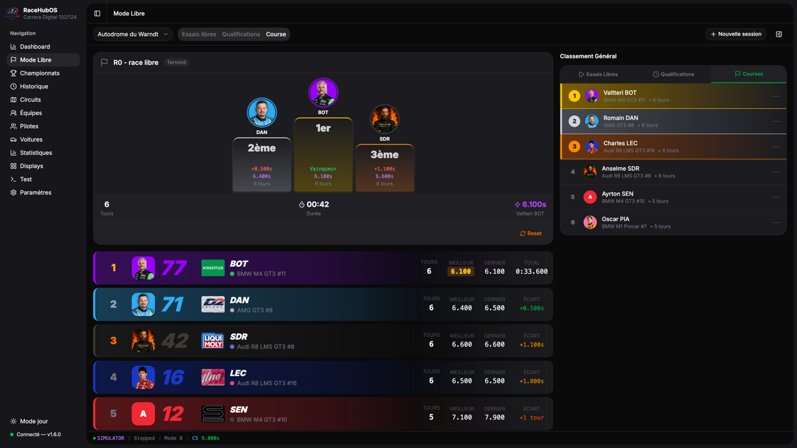
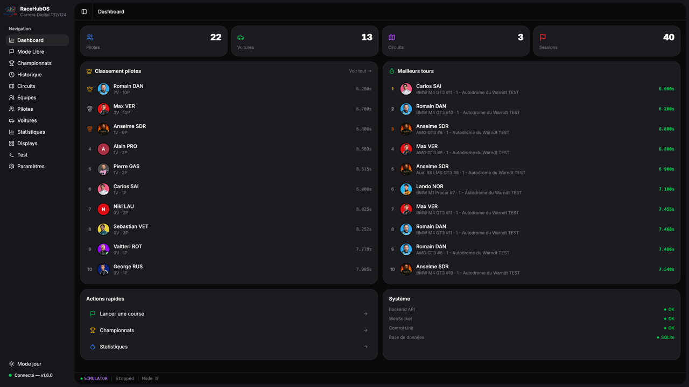
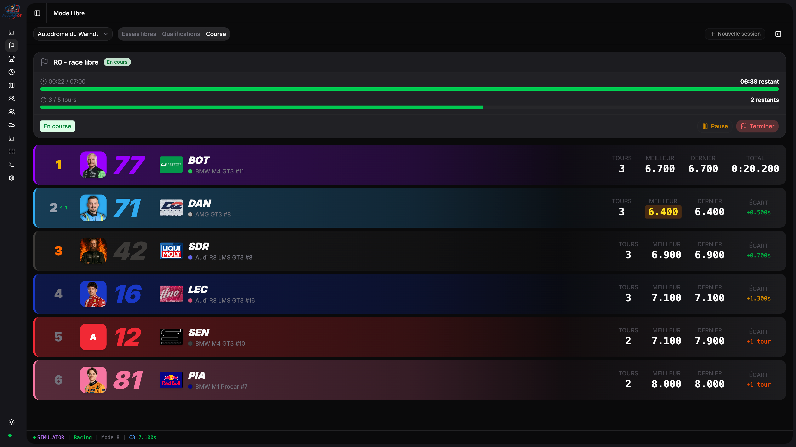
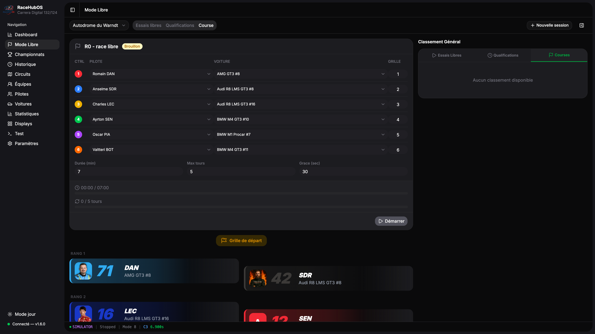
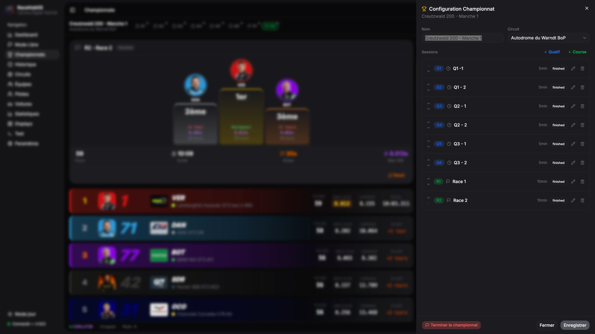
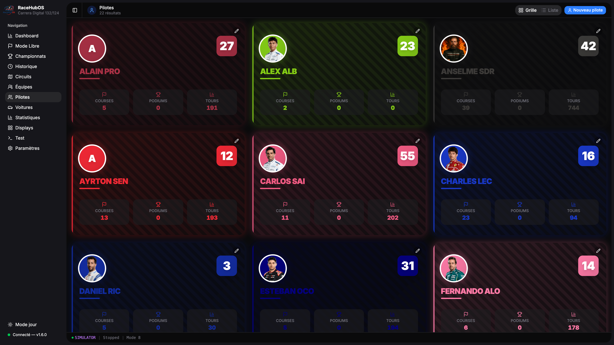
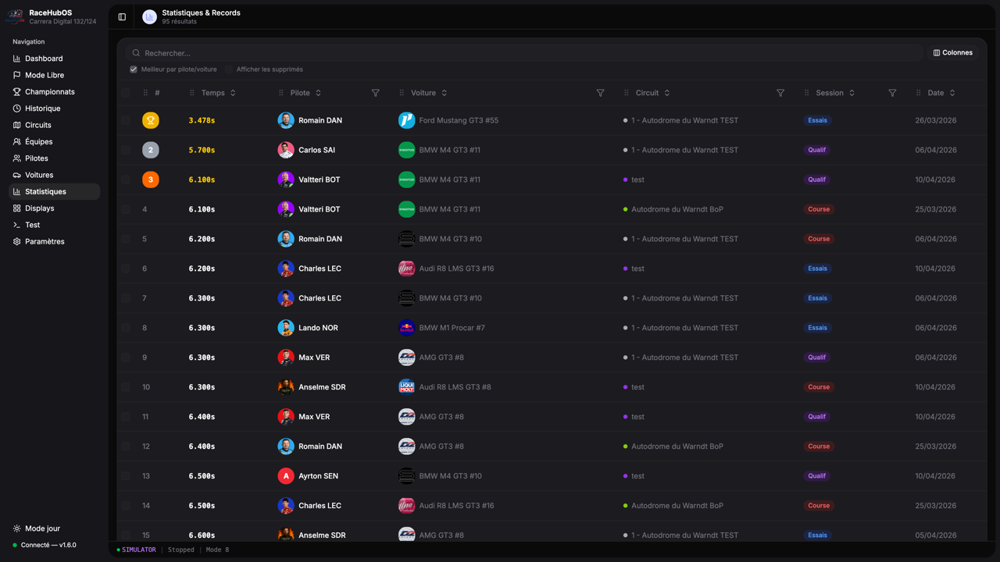
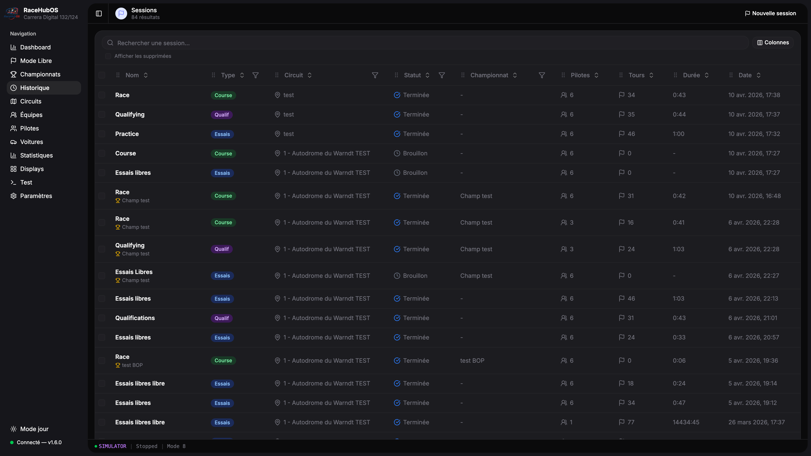
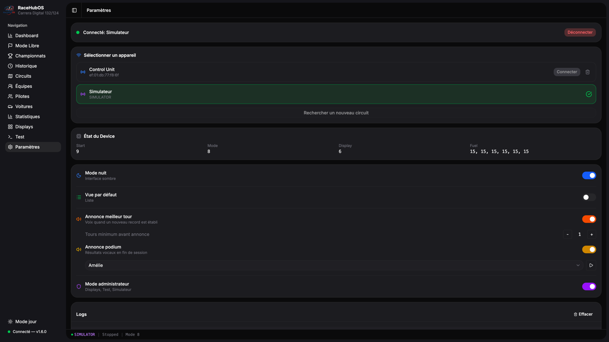

# 🏁 RaceHubOS

**Free & open source race management for Carrera Digital 132/124**



Carrera dropped their official app. Existing alternatives are closed source. We believe slot racing deserves an open, community-driven tool that anyone can use, improve, and adapt to their setup.

RaceHubOS is a full-featured race management system that runs in your browser. Plug your Carrera Control Unit, open a browser, and race.

Built by slot racers, for slot racers. 🏎️

**[English](#-features)** | **[Français](#-version-française)**

---

## Table of Contents

- [Features](#-features)
- [Tech Stack](#️-tech-stack)
- [Getting Started](#-getting-started)
  - [Prerequisites](#prerequisites)
  - [macOS / Linux](#-macos---linux)
  - [Windows](#-windows)
  - [Upgrade](#-upgrade)
- [Add-ons](#-add-ons)
- [Development](#-development)
  - [Simulator](#-simulator)
  - [WebSocket Events](#-websocket-events)
- [Contributing](#-contributing)
- [License](#-license)
- [Credits](#-credits)
- [Version française](#-version-française)

---

## ✨ Features

- 📊 Real-time race leaderboard with animated positions
- 👤 Driver, car, track and team management
- 🏆 Championship system: manual or automatic mode (auto bracket, qualif groups, race progression)

- 📈 Standings and statistics per championship and session type
- ⚙️ Inline session configuration (controllers, duration, laps, grace period)
- 🥇 Podium display at end of session with gaps and best lap
- 🗣️ Voice announcements (best lap, podium results)
- 🎙️ Configurable voice settings (voice selection, min laps threshold)
- 🚦 Start lights sequence with audio cues
- 🌙 Dark/light mode
- 🔌 Bluetooth LE connectivity to Carrera Control Unit via AppConnect
- 🎮 Built-in simulator for development (no hardware required)
- ⚖️ Car balancing mode with lap time chart, median tracking and outlier filtering
- 🧩 Add-ons: extra features installed from the app, see [Add-ons](#-add-ons)

## 🛠️ Tech Stack

**Frontend:**
- React 19 + JavaScript (ES6+)
- Vite
- TailwindCSS + shadcn/ui
- Socket.io-client
- Framer Motion

**Backend:**
- Node.js 20+ + JavaScript (ES6+ modules)
- Express + Socket.io
- Prisma + SQLite (WAL mode)
- Built-in race simulator

## 🚀 Getting Started

The script handles everything automatically:
- Installs Homebrew, Git, and Node.js if missing
- Clones the repo into `~/RaceHubOS-v<version>`
- Installs dependencies and sets up the database
- Creates a **RaceHubOS v\<version\>.app** on the Desktop with the project icon

### 🍎 macOS / 🐧 Linux

1. Download `RaceHubOS-install-mac.command` from the [repo](https://github.com/AnselmeSDR/RaceHubOS)
2. Double-click to run (right-click > Open if macOS blocks it)

### 🪟 Windows

1. Download `RaceHubOS-install-win.bat` from the [repo](https://github.com/AnselmeSDR/RaceHubOS)
2. Double-click to run

### 🖥️ Usage

Double-click the **RaceHubOS** app/shortcut on the Desktop. The browser opens automatically after a few seconds.

### 🔄 Upgrade

Updates are handled from within the app:
1. Open **Settings**
2. Click **Vérifier** to check for updates
3. If available, click **Mettre à jour**
4. The app downloads, installs and restarts automatically

## 🧩 Add-ons

Add-ons bring features to RaceHubOS without changing its core: a page in the menu, a column in a list, a badge on a car, something that happens at the end of each session.

Open **Add-ons** in the menu:

- **Market**: the add-ons listed by the maintainer, installed in one click.
- **Install from a link**: any git repository (GitLab, GitHub…). Nobody has reviewed it, and an add-on runs with the same rights as RaceHubOS: install only what you trust.
- **Installed**: enable, disable, update when a new version is out, or remove each add-on, with or without its data.

The database is backed up before each action. RaceHubOS then rebuilds and restarts on its own, and an add-on that breaks the build is disabled.

| Add-on | What it does |
|---|---|
| [Car service](https://gitlab.com/AnselmeSDR/racehubos-car-service) | Laps and distance of each car since its last service, an interval per car, and the cars due: a page, a badge on the car and a column in the cars list |

**Writing an add-on**: [docs/ADDONS.md](docs/ADDONS.md) covers the folder layout, the manifest, the server and web sides, data, changing core files (overrides), publishing, and the rules for AI assistants. Car service is a complete example, tests included.

## 🧑‍💻 Development

### Prerequisites

- Node.js 20+
- npm 10+
- Git

> **Note:** In production, `npm run build && npm start` builds the frontend and starts the backend on a single port (3001). In development, `npm run dev` runs both Vite and Express with hot reload.

### 📦 Setup

```bash
git clone https://github.com/AnselmeSDR/RaceHubOS.git
cd RaceHubOS
npm install
cd packages/backend && npx prisma generate && npx prisma migrate deploy && cd ../..
npm run dev
```

The frontend will be available at http://localhost:5173 and the backend API at http://localhost:3001.

### 🎮 Simulator

The built-in simulator mimics the Carrera Control Unit. No hardware required.

1. Open Settings
2. Connect to "Simulator"
3. Configure a session and start

### 🔌 WebSocket Events

Key events emitted by the backend:
- `session:leaderboard` — Real-time leaderboard updates
- `session:heartbeat` — Timing, remaining time/laps, leaderboard sync
- `session:bestlap` — New session best lap (triggers voice announcement)
- `session:finished` — Session end with final leaderboard
- `session:status_changed` — Session lifecycle transitions
- `cu:status` — Control Unit status (lights, mode, fuel)
- `cu:timer` — Raw lap/sector times from hardware

## 🤝 Contributing

RaceHubOS is an active project with a lot of room to grow. Here are some directions we'd love help with:

- 🍓 **Raspberry Pi** — Run the app on a dedicated Pi for a permanent race station
- 📱 **Tablet control** — Touch-friendly interface for race direction from a tablet
- 📺 **External displays** — Dedicated screens for spectators (leaderboard, live timing, standings)
- 🏗️ **Packaged builds** — Standalone `.exe`, `.AppImage` for easier distribution
- 🧩 **New features** — Penalties, fuel strategy, team relay races, lap charts, and more
- **Ideas & bugs** — [Open an issue](https://github.com/AnselmeSDR/RaceHubOS/issues)
- **Code** — Fork, branch, and submit a pull request — read [CONTRIBUTING.md](CONTRIBUTING.md) first
- **Add-ons** — Add a feature without changing the core — read [docs/ADDONS.md](docs/ADDONS.md)
- **Questions** — Reach out at anselme8@icloud.com

All contributions are welcome — whether it's a feature, a bug fix, a design idea, or just feedback.

## 📄 License

[AGPL-3.0](LICENSE) — free to use, modify and share; any modified version you distribute or offer as an online service must stay open source under the same license. A commercial license is available for closed-source use: anselme8@icloud.com.

## 🙏 Credits

**Project**
- Anselme Schneider — Founder & Developer (anselme8@icloud.com)
- Romain Danna — Co-author (domain & race expertise)

**Libraries & References**
- Protocol reverse engineering: [Stephan Hess (slotbaer.de)](http://www.slotbaer.de/)
- [carreralib](https://github.com/tkem/carreralib): Thomas Kemmer
- [OpenLap](https://github.com/tkem/openlap): Thomas Kemmer
- License notices: [THIRD_PARTY_NOTICES.md](THIRD_PARTY_NOTICES.md)

Vibe coded with [Claude Code](https://claude.ai/code)

---

## 🇫🇷 Version française

Carrera a abandonné son app officielle. Les alternatives existantes sont fermées. On pense que le slot racing mérite un outil ouvert et communautaire que chacun peut utiliser, améliorer et adapter à son installation.

RaceHubOS est un système complet de gestion de course qui tourne dans le navigateur. Branchez votre Control Unit Carrera, ouvrez un navigateur, et roulez.

Fait par des passionnés de slot, pour des passionnés de slot. 🏎️

### Fonctionnalités

- 📊 Classement en temps réel avec animations de positions
- 👤 Gestion des pilotes, voitures, circuits et équipes
- 🏆 Système de championnat : mode manuel ou automatique (arbre qualifs/courses, progression auto)

- 📈 Classements et statistiques par championnat et type de session
- ⚙️ Configuration de session inline (contrôleurs, durée, tours, période de grâce)
- 🥇 Podium en fin de session avec écarts et meilleur tour
- 🗣️ Annonces vocales (meilleur tour, résultats podium)
- 🎙️ Réglages voix configurables (choix de la voix, seuil de tours minimum)
- 🚦 Séquence de feux de départ avec sons
- 🌙 Mode sombre/clair
- 🔌 Connexion Bluetooth LE à la Control Unit Carrera via AppConnect
- 🎮 Simulateur intégré pour le développement (pas de matériel requis)
- ⚖️ Mode équilibrage voitures avec graphe temps au tour, suivi médiane et filtre outliers
- 🧩 Add-ons : des fonctionnalités en plus, installées depuis l'application, voir [Add-ons](#add-ons)

### Installation

#### macOS / Linux — Installation en un clic

1. Télécharger `RaceHubOS-install-mac.command` depuis le [dépôt](https://github.com/AnselmeSDR/RaceHubOS)
2. Double-cliquer pour lancer (clic droit > Ouvrir si macOS le bloque)

Le script gère tout : installe Homebrew/Git/Node.js si absents, clone, installe les dépendances, configure la base de données, et crée une app **RaceHubOS v\<version\>** sur le Bureau avec l'icône.

#### Windows — Installation en un clic

1. Télécharger `RaceHubOS-install-win.bat` depuis le [dépôt](https://github.com/AnselmeSDR/RaceHubOS)
2. Double-cliquer pour lancer

Le script gère tout : installe Git/Node.js via winget si absents, clone, installe les dépendances, configure la base de données, et crée un raccourci **RaceHubOS v\<version\>** sur le Bureau avec l'icône.

#### Installation manuelle

```bash
git clone https://github.com/AnselmeSDR/RaceHubOS.git
cd RaceHubOS
npm install
cd packages/backend && npx prisma generate && npx prisma migrate deploy && cd ../..
npm run dev
```

Le frontend est accessible sur http://localhost:5173 et l'API backend sur http://localhost:3001.

#### Mise à jour

Les mises à jour se font depuis l'application :
1. Ouvrir **Paramètres**
2. Cliquer **Vérifier** pour chercher les mises à jour
3. Si disponible, cliquer **Mettre à jour**
4. L'app télécharge, installe et redémarre automatiquement

> **Note :** En production, `npm run build && npm start` build le frontend et lance le backend sur un seul port (3001). En développement, `npm run dev` lance Vite et Express avec hot reload.

### Add-ons

Les add-ons ajoutent des fonctionnalités à RaceHubOS sans toucher au cœur : une page dans le menu, une colonne dans une liste, un badge sur une voiture, une action à la fin de chaque session.

Ouvrez **Add-ons** dans le menu :

- **Catalogue** : les add-ons listés par le mainteneur, installés en un clic.
- **Installer depuis un lien** : n'importe quel dépôt git (GitLab, GitHub…). Personne ne l'a vérifié, et un add-on a les mêmes droits que RaceHubOS : n'installez que ce en quoi vous avez confiance.
- **Installés** : activer, désactiver, mettre à jour quand une nouvelle version sort, ou désinstaller chaque add-on, avec ou sans ses données.

La base est sauvegardée avant chaque action. RaceHubOS se reconstruit ensuite et redémarre seul, et un add-on qui casse le build est désactivé.

| Add-on | Ce qu'il fait |
|---|---|
| [Entretien des voitures](https://gitlab.com/AnselmeSDR/racehubos-car-service) | Tours et distance de chaque voiture depuis son dernier entretien, un intervalle par voiture, et les voitures à entretenir : une page, un badge sur la voiture et une colonne dans la liste des voitures |

**Écrire un add-on** : [docs/ADDONS.md](docs/ADDONS.md) (en anglais) décrit l'arborescence, le manifeste, les côtés serveur et web, les données, la modification des fichiers du cœur (overrides), la publication, et les règles pour les assistants IA. Entretien des voitures est un exemple complet, tests compris.

### Stack technique

**Frontend :** React 19, Vite, TailwindCSS + shadcn/ui, Socket.io-client, Framer Motion

**Backend :** Node.js 20+, Express + Socket.io, Prisma + SQLite (WAL), Simulateur intégré

### Développement

#### Prérequis

- Node.js 20+
- npm 10+
- Git

> **Note :** En production, `npm run build && npm start` build le frontend et lance le backend sur un seul port (3001). En développement, `npm run dev` lance Vite et Express avec hot reload.

#### Installation

```bash
git clone https://github.com/AnselmeSDR/RaceHubOS.git
cd RaceHubOS
npm install
cd packages/backend && npx prisma generate && npx prisma migrate deploy && cd ../..
npm run dev
```

Le frontend est accessible sur http://localhost:5173 et l'API backend sur http://localhost:3001.

#### Simulateur

Le simulateur intégré reproduit le comportement de la Control Unit Carrera. Aucun matériel requis.

1. Ouvrir les Paramètres
2. Se connecter au "Simulateur"
3. Configurer une session et démarrer

#### Événements WebSocket

Événements principaux émis par le backend :
- `session:leaderboard` — Classement en temps réel
- `session:heartbeat` — Timing, temps/tours restants, sync leaderboard
- `session:bestlap` — Nouveau meilleur tour de session (déclenche l'annonce vocale)
- `session:finished` — Fin de session avec classement final
- `session:status_changed` — Transitions du cycle de vie de la session
- `cu:status` — État de la Control Unit (feux, mode, carburant)
- `cu:timer` — Temps bruts tours/secteurs depuis le matériel

### Contribuer

Le projet est en développement actif et ouvert aux contributions :

- 🍓 **Raspberry Pi** — Faire tourner l'app sur un Pi dédié
- 📱 **Contrôle tablette** — Interface tactile pour la direction de course
- 📺 **Écrans externes** — Affichages dédiés pour les spectateurs
- 🏗️ **Builds packagés** — Exécutables standalone
- 🧩 **Nouvelles features** — Pénalités, stratégie carburant, relais par équipe, graphiques de tours, etc.
- **Idées et bugs** — [Ouvrir une issue](https://github.com/AnselmeSDR/RaceHubOS/issues)
- **Code** — Fork, branche, et pull request — lire d'abord [CONTRIBUTING.md](CONTRIBUTING.md)
- **Add-ons** — Ajouter une fonctionnalité sans toucher au cœur — lire [docs/ADDONS.md](docs/ADDONS.md)
- **Questions** — anselme8@icloud.com

### Licence

[AGPL-3.0](LICENSE) — libre d'utiliser, de modifier et de partager ; toute version modifiée, distribuée ou proposée en service en ligne, doit rester open source sous la même licence. Une licence commerciale est disponible pour un usage en code fermé : anselme8@icloud.com.

### Crédits

**Projet**
- Anselme Schneider — Fondateur & Développeur (anselme8@icloud.com)
- Romain Danna — Co-auteur (expertise course & métier)

**Librairies & Références**
- Reverse engineering du protocole : [Stephan Hess (slotbaer.de)](http://www.slotbaer.de/)
- [carreralib](https://github.com/tkem/carreralib) : Thomas Kemmer
- [OpenLap](https://github.com/tkem/openlap) : Thomas Kemmer
- Mentions de licence : [THIRD_PARTY_NOTICES.md](THIRD_PARTY_NOTICES.md)

Vibe codé avec [Claude Code](https://claude.ai/code)

---

## 📸 Screenshots

| | |
|---|---|
|  **Dashboard** |  **Race** |
|  **Free Session** |  **Championships** |
|  **Drivers** |  **Statistics** |
|  **Sessions** |  **Settings** |
