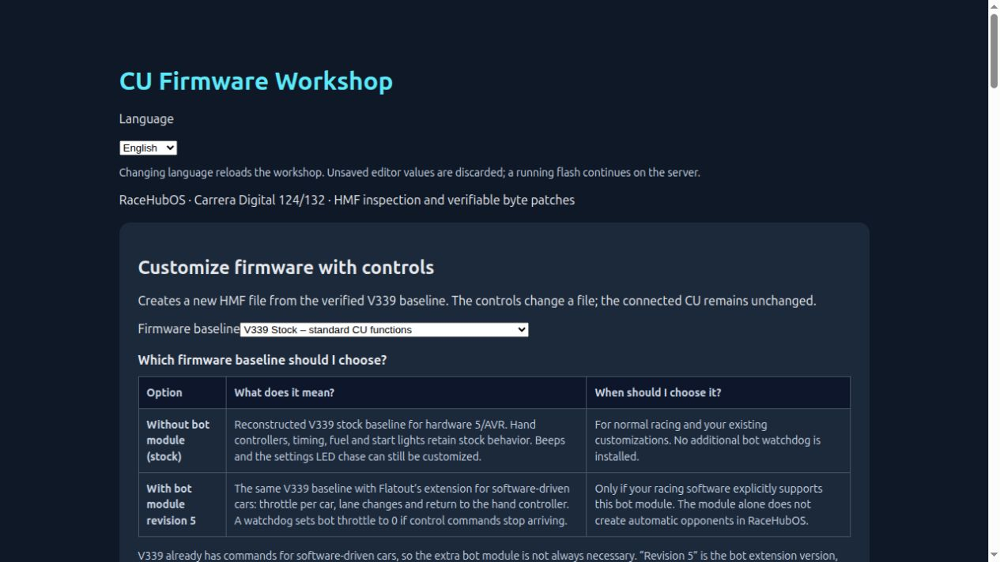
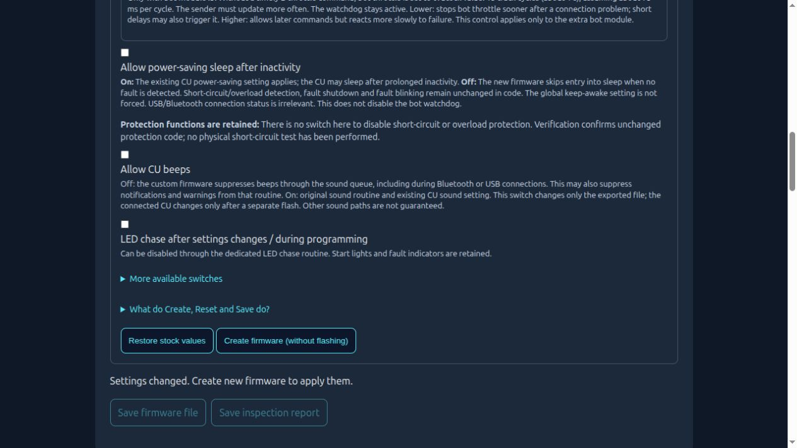
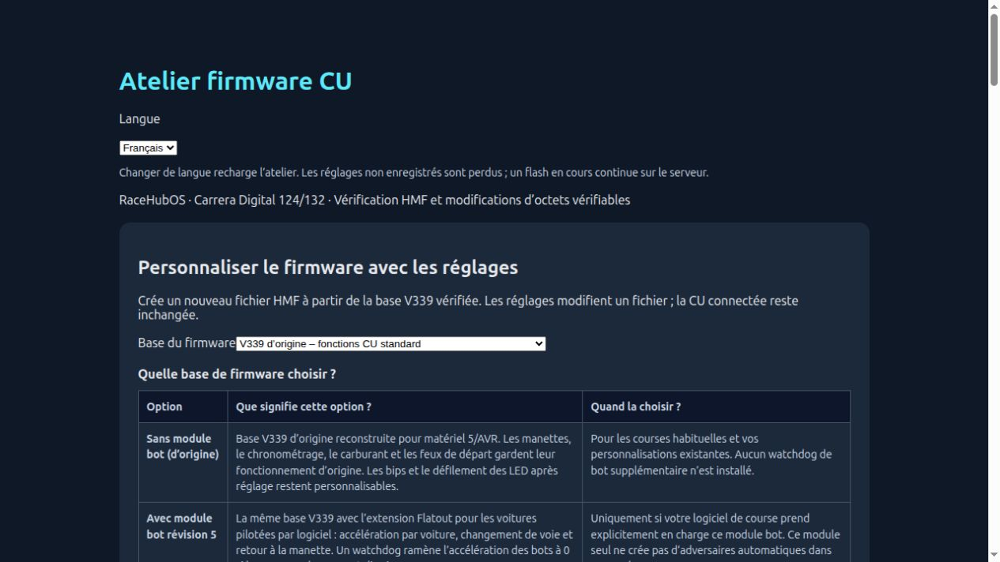
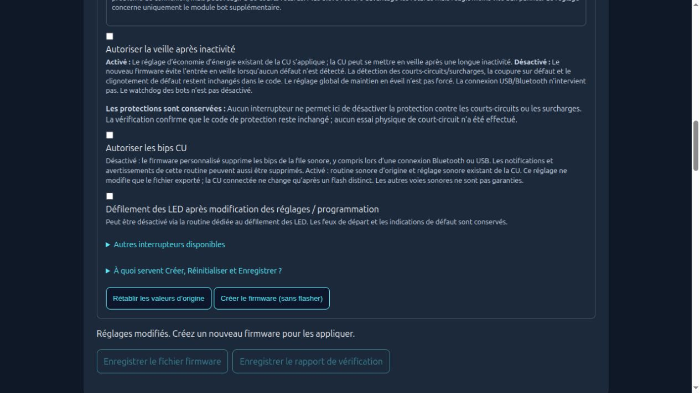

# CU Firmware Workshop · RaceHubOS 1.27 · 0.6.1

[Deutsch](README-DE.md) · English · Français

A native RaceHubOS add-on for inspecting HMF files, editing verified V339 Stock/Bot.5 profiles, and explicitly flashing or recovering a **hardware 5 / AVR** Control Unit. Hardware 8 / STM32 is rejected. Firmware sources and their upstream licenses are included under `vendor/flatout/firmware`.

## English

The workshop follows the RaceHubOS interface language (`de`, `en`, `fr`). A separate language selector is also available inside the workshop. Changing that selector reloads the editor and discards unsaved selections; an active flash continues on the server. Controls, explanations, accessible labels and UI messages are translated. Machine-readable JSON reports and diagnostic records retain their existing schema, identifiers and original text for compatibility.

The controls cover sensor-event spacing, debounce, the optional bot watchdog, CU sound, settings LED chase, idle sleep, sensor tones and stock PC car control. Editing or exporting a file does not flash the CU. Short-circuit/overload code and start lights are retained by supported profiles; file validation does not substitute for hardware testing.

### Installation

This branch contains the add-on as a reviewable snapshot under `addons/cu-firmware`; it changes no core files. Copy that directory into an existing **RaceHubOS 1.27.0** installation, or link it there. From the RaceHubOS root, build the frontend with `npm run build`, then restart RaceHubOS. The page is `/addons/cu-firmware`. The service deliberately refuses other core versions until verified.

### Validation

From the RaceHubOS root, with development dependencies installed:

```sh
node addons/cu-firmware/tests/i18n.test.mjs
node addons/cu-firmware/tests/parameters.test.mjs
node --import ./packages/backend/src/addons/preload.js addons/cu-firmware/tests/flash.test.mjs
node --import ./packages/backend/src/addons/preload.js addons/cu-firmware/tests/exports.test.mjs
npm run build
```

The flash tests use simulated BLE hardware. The export test binds a local loopback port. See [validation notes](docs/validation-0.6.1.md).

## Français

L’atelier suit la langue de RaceHubOS : allemand, anglais ou français. Un sélecteur indépendant est également disponible dans l’atelier. Changer de langue recharge l’éditeur et perd les réglages non enregistrés ; un flash en cours continue sur le serveur. Les commandes, explications, libellés accessibles et messages de l’interface sont traduits. Les rapports JSON et diagnostics techniques conservent leur format et leur texte d’origine.

Ce module concerne uniquement les CU **matériel 5 / AVR**, avec les profils V339 d’origine ou Bot.5 vérifiés. Le matériel 8 / STM32 est refusé. Pour l’installation, copiez ou liez le dossier `addons/cu-firmware` dans RaceHubOS **1.27.0**, exécutez `npm run build` puis redémarrez RaceHubOS. Ouvrez `/addons/cu-firmware`.

Modifier ou exporter un fichier ne lance aucun flash. Les protections contre les courts-circuits/surcharges et les feux de départ sont conservés dans le code des profils compatibles ; la vérification d’un fichier ne remplace pas un test matériel.

## Screenshots

English:




Français :



