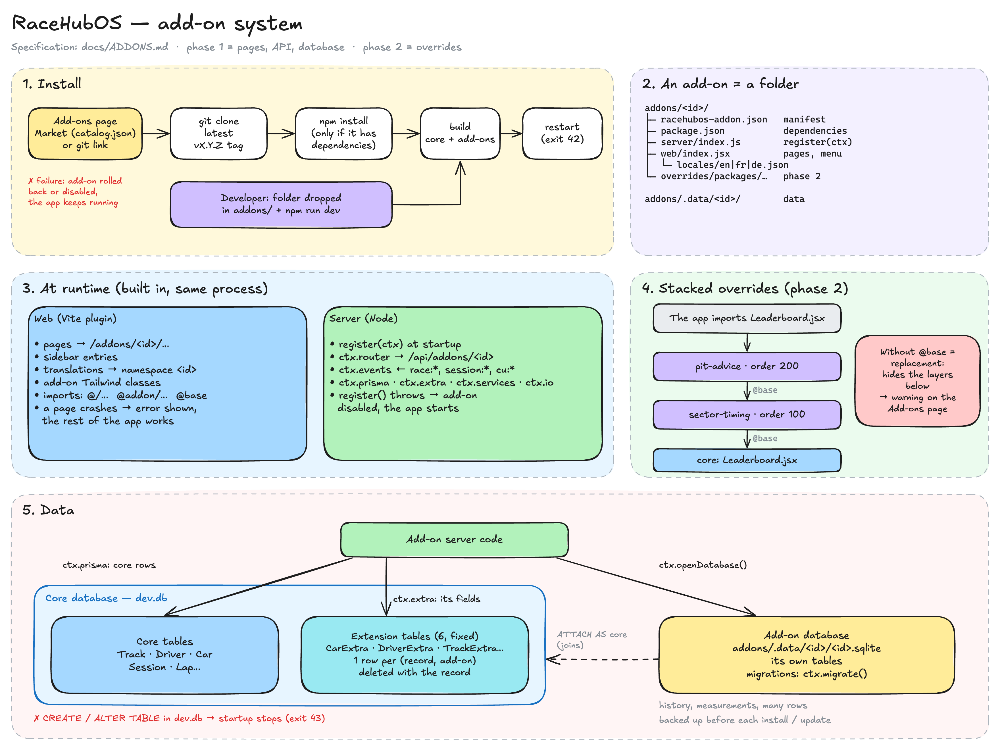

# RaceHubOS add-ons

> **Status: design agreed, implementation in progress.** This guide is the contract the implementation follows. Until it ships, treat it as the specification.

An add-on adds a feature to RaceHubOS without changing the core repository. It is a folder of ordinary RaceHubOS code (React on the web side, Node on the server side), built into the app and run in the same process.

**Add-ons are fully trusted.** They have no sandbox and no permission system, and they can do anything the core can do. That is the point: an add-on is a feature that lives outside the core, not a widget in a box. In return, an add-on is open source, and the user chooses to install it.

This guide is written for both human developers and AI assistants. The [rules for AI assistants](#rules-for-ai-assistants) section is a checklist you can hand to your AI.



_Source: [addons-architecture.excalidraw](addons-architecture.excalidraw), editable on [excalidraw.com](https://excalidraw.com)._

---

## Contents

- [Phases](#phases)
- [Quick start](#quick-start)
- [Folder layout](#folder-layout)
- [Manifest](#manifest)
- [Server side](#server-side)
- [Web side](#web-side)
- [Data](#data)
- [Changing existing code (overrides)](#changing-existing-code-overrides)
- [Installing, updating, removing](#installing-updating-removing)
- [Publishing an add-on](#publishing-an-add-on)
- [When something breaks](#when-something-breaks)
- [Rules for AI assistants](#rules-for-ai-assistants)
- [Example: track planner](#example-track-planner)
- [How it works inside the core](#how-it-works-inside-the-core)

---

## Phases

| Phase | An add-on can                                                                                   |
| ----- | ----------------------------------------------------------------------------------------------- |
| 1     | add pages and sidebar entries, add API routes, read and write the database, listen to race events |
| 2     | change any existing page or module of the core, through [overrides](#changing-existing-code-overrides) |

Phase 2 keeps everything from phase 1. An add-on written for phase 1 keeps working.

---

## Quick start

```bash
cd racehubos
mkdir -p addons/hello && cd addons/hello
```

`addons/hello/racehubos-addon.json`:

```json
{ "id": "hello", "name": "Hello", "version": "0.1.0" }
```

`addons/hello/web/index.jsx`:

```jsx
import { lazy } from 'react'
import { Hand } from 'lucide-react'

export default {
  routes: [{ path: '', component: lazy(() => import('./HelloPage.jsx')) }],
  nav: [{ to: '', labelKey: 'nav', Icon: Hand }],
}
```

`addons/hello/web/HelloPage.jsx`:

```jsx
import { useTranslation } from 'react-i18next'
import { Card, CardContent } from '@/components/ui/card'
import { useFetch } from '@/hooks'

export default function HelloPage() {
  const { t } = useTranslation('hello')
  const { data: tracks = [] } = useFetch('/api/tracks')
  return (
    <Card>
      <CardContent className="p-6">{t('trackCount', { count: tracks.length })}</CardContent>
    </Card>
  )
}
```

`addons/hello/web/locales/en.json`:

```json
{ "nav": "Hello", "trackCount": "{{count}} tracks in the database" }
```

Then run `npm run dev` from the repository root. **Hello** appears in the sidebar, and the page lives at `/addons/hello`.

Restart `npm run dev` when you add an add-on or a new override file. Editing existing files reloads on its own: the web side through Vite hot reload, the server side through `node --watch`.

To test with race data, connect the **Simulator** in Settings. You don't need a Control Unit.

---

## Folder layout

```
addons/<id>/
├── racehubos-addon.json     required: the manifest
├── package.json             optional: the add-on's own npm dependencies
├── server/index.js          optional: server entry, exports register(ctx)
├── web/
│   ├── index.jsx            optional: web entry, exports { routes, nav }
│   └── locales/<lang>.json  translations, namespace = <id>
└── overrides/               phase 2: files that replace or wrap core files
    └── packages/frontend/src/components/race/Leaderboard.jsx
```

Everything is optional except the manifest. An add-on can have only a server, only pages, or only overrides.

The `addons/` folder is ignored by the core's git repository. Core updates never touch it.

---

## Manifest

`racehubos-addon.json`:

```json
{
  "id": "track-planner",
  "name": "Track planner",
  "description": "Draw your Carrera track and save it to RaceHubOS.",
  "version": "0.1.0",
  "author": "WillibaldSoft",
  "license": "Apache-2.0",
  "repository": "https://github.com/<owner>/racehubos-track-planner",
  "order": 100
}
```

| Field                                | Notes                                                                                                              |
| ------------------------------------ | ------------------------------------------------------------------------------------------------------------------ |
| `id`                                 | **Required.** Lowercase kebab-case, the same as the folder name, unique. It is used as the API prefix, the translation namespace, the event prefix and the data folder name. |
| `name`                               | **Required.** Shown on the Add-ons page. Can be a string or `{ "en": "…", "fr": "…", "de": "…" }`.                 |
| `version`                            | **Required.** Semver. Tag each release `vX.Y.Z`.                                                                    |
| `description`                        | Same format as `name`.                                                                                              |
| `author`, `license`, `repository`    | Shown on the Add-ons page.                                                                                          |
| `order`                              | Position in override stacks, default `100`. Lower is closer to the core. See [stacking](#stacking).                |

There is no "compatible with RaceHubOS version" field. A core update never blocks an add-on. If an add-on breaks, it is disabled and the user is told why (see [when something breaks](#when-something-breaks)).

---

## Server side

`server/index.js` exports a function that receives the context `ctx`:

```js
export default async function register(ctx) {
  // GET /api/addons/<id>/best-sectors/:trackId
  ctx.router.get('/best-sectors/:trackId', async (req, res) => {
    const db = ctx.openDatabase()
    const rows = db.prepare('SELECT * FROM best_sector WHERE track_id = ?').all(req.params.trackId)
    res.json({ success: true, data: rows })
  })

  ctx.events.on('race:sector', (data) => {
    // every event the core sends to the browsers also reaches the add-on
  })

  ctx.services.session.on('sessionFinished', async ({ sessionId }) => {
    const laps = await ctx.prisma.lap.findMany({ where: { sessionId } })
    ctx.io.emit(`${ctx.id}:updated`, { sessionId, laps: laps.length })
  })

  // optional: called on shutdown
  return () => {}
}
```

| `ctx.…`           | What it is                                                                                                                       |
| ----------------- | -------------------------------------------------------------------------------------------------------------------------------- |
| `id`, `manifest`  | The add-on's id and its parsed manifest.                                                                                         |
| `router`          | An Express router mounted at `/api/addons/<id>`.                                                                                 |
| `app`             | The Express app itself, for anything the router can't do.                                                                        |
| `io`              | The socket.io server. Prefix your events with `<id>:`.                                                                           |
| `events`          | Receives every event the core emits to clients (`race:leaderboard`, `race:sector`, `race:pitStop`, `race:carData`, `session:*`, `cu:*`…). An exception in a listener is caught and logged, so it can't crash the server. |
| `prisma`          | The Prisma client of the core database. Queries on the `*Extra` tables are limited to this add-on's rows. See [Data](#data).     |
| `extra`           | The add-on's own fields on core records (`get`, `set`, `remove`, `all`). See [extra fields](#extra-fields-on-core-records).       |
| `services`        | The core's running instances: `session`, `championship`, `config`, `sync`, `controlUnit`, `simulator`. `session` also emits `sessionFinished`, `sessionReset` and `sessionDeleted`. Unlike `ctx.events` listeners, your listeners on these services are not wrapped: catch your own errors. |
| `dataDir`         | A folder that persists across core and add-on updates: `addons/.data/<id>/`.                                                     |
| `openDatabase()`  | The add-on's own SQLite database (`better-sqlite3`, WAL mode), stored in `dataDir`, with the core database attached as `core`. It always returns the same connection. |
| `migrate(steps)`  | Runs the add-on's own schema migrations on that database. See [own database](#own-database).                                     |
| `log`             | `info`, `warn`, `error`, prefixed with `[addon:<id>]`.                                                                           |
| `version`         | The RaceHubOS version.                                                                                                           |

`register` runs before the server starts listening. Set things up and return; don't `await` anything slow, like network calls.

You can also import core code directly. These imports get the same instances the core uses:

```js
import { SessionType, isSessionType } from '@racehubos/shared'
import { backupDatabase } from '@racehubos/backend/src/lib/backupDatabase.js'
```

---

## Web side

`web/index.jsx` declares pages and sidebar entries:

```jsx
import { lazy } from 'react'
import { PenTool } from 'lucide-react'

export default {
  routes: [
    { path: '', component: lazy(() => import('./pages/Home.jsx')) },
    { path: ':trackId', component: lazy(() => import('./pages/Editor.jsx')) },
    { path: 'screen', component: lazy(() => import('./pages/Screen.jsx')), layout: false },
  ],
  nav: [{ to: '', labelKey: 'nav', Icon: PenTool }],
}
```

- Routes are mounted under `/addons/<id>/`. Here they are `/addons/track-planner`, `/addons/track-planner/:trackId` and `/addons/track-planner/screen`.
- `layout: false` renders the page without the sidebar, for displays and full-screen tools.
- `nav[].to` is relative to `/addons/<id>`. `labelKey` is looked up in the add-on's namespace. `adminOnly: true` hides the entry from non-admin devices, as for core entries.
- Each add-on page is wrapped in an error boundary. A crash shows the error on that page, and the rest of the app keeps working.

### Translations

`web/locales/en.json`, `fr.json` and `de.json` are loaded into the namespace `<id>`:

```jsx
const { t } = useTranslation('track-planner')
t('nav')
t('track', { ns: 'glossary', count: 2 }) // core namespaces stay available
```

Provide `en`, `fr` and `de`. A missing key falls back to English.

### Using the core

Everything in the frontend is importable through `@/`:

| Import                                          | For                                                         |
| ----------------------------------------------- | ----------------------------------------------------------- |
| `@/components/ui/*`                             | shadcn components (`Button`, `Card`, `Dialog`, `Badge`…)    |
| `@/hooks` (`useFetch`, `useWebSocket`)          | API calls and socket events                                 |
| `@/context/SessionContext` (`useSession`)       | the running session, live                                   |
| `@/context/AppContext` (`useApp`)               | device and app state                                        |
| `@racehubos/shared`                             | session types, statuses, car specs                          |
| `@addon/…`                                      | your own add-on's root (`@addon/web/components/Foo.jsx`)    |

Style pages with Tailwind and the theme tokens (`bg-card`, `text-muted-foreground`, `border-border`…), so that dark mode and the theme follow. Tailwind classes used in add-ons are generated like core ones.

### Dependencies

Put your own dependencies in the add-on's `package.json`. They are installed with `npm install --omit=dev` in the add-on folder.

Don't add what the core already provides: `react`, `react-dom`, `react-router-dom`, `i18next`, `react-i18next`, `socket.io-client`, `lucide-react`, `express`, `@prisma/client`, `better-sqlite3`. These must exist only once in the app. A second React copy breaks hooks. You can list them under `peerDependencies` for documentation.

---

## Data

| You need to…                                                           | Use                                                    |
| ---------------------------------------------------------------------- | ------------------------------------------------------ |
| read or write core records (tracks, cars, drivers, sessions, laps…)    | `ctx.prisma`, or the core API from the web side        |
| add fields to a core record (a car's tyre, a track's banking)          | [`ctx.extra`](#extra-fields-on-core-records)           |
| store your own data (history, measurements, anything with many rows)   | [your own database](#own-database)                     |
| store files (images, exports)                                          | `ctx.dataDir`                                          |

**Never change the core schema.** That means no Prisma migration, no edits to `schema.prisma`, and no `CREATE TABLE` or `ALTER TABLE` on the core database. At startup, the core checks that its database matches a known migration state. A database with an unknown table or column stops the app with exit code 43.

### Core records

Read and write them freely. For example, the track planner saves to `Track.layout` through `PUT /api/tracks/:id`.

### Extra fields on core records

To add fields to a car, a driver, a track, a team, a session or a championship, don't add a column. The core has one extension table per record type: `CarExtra`, `DriverExtra`, `TrackExtra`, `TeamExtra`, `SessionExtra` and `ChampionshipExtra`. Each holds **one row per record and per add-on**, with that add-on's fields as JSON:

```
CarExtra
carId    addon           data
car_42   tyre-catalog    {"tyre":"soft","grip":3}
car_42   pit-advice      {"tankSize":15}
```

```js
const { tyre } = await ctx.extra.get('car', carId) // {} when nothing is stored
await ctx.extra.set('car', carId, { grip: 4 }) // merged into this add-on's fields
await ctx.extra.remove('car', carId) // this add-on's row only
const byCar = await ctx.extra.all('car') // { [carId]: data } for this add-on
```

- **Each add-on only touches its own rows.** `ctx.extra` fills in the add-on id itself. `ctx.prisma` also adds `addon = <id>` to every query on the `*Extra` tables, so even a careless `deleteMany()` can't erase another add-on's fields.
- **The fields follow the record.** Deleting a car deletes its extras, the core backups include them, and the core API returns them with the record: `GET /api/cars/:id` → `{ …, extras: { "tyre-catalog": { … } } }`.
- **From the web side**, read them from that `extras` field and write them with `PUT /api/addons/<id>/extras/car/:carId` (JSON body, merged like `set`).
- **No index on these fields.** That's fine for tens or hundreds of records. For data you need to search or sort quickly, use your own database.

The record types are `car`, `driver`, `track`, `team`, `session` and `championship`.

### Own database

`ctx.openDatabase()` returns the add-on's own SQLite database, stored in `addons/.data/<id>/`. Declare its schema as a list of steps:

```js
ctx.migrate([
  `CREATE TABLE best_sector (track_id TEXT, sector INTEGER, time INTEGER, PRIMARY KEY (track_id, sector))`,
  `ALTER TABLE best_sector ADD COLUMN car_id TEXT`, // added in v0.2.0
])
```

Each step runs once, in order, and the version is kept in `PRAGMA user_version`. Add new steps at the end. Never edit or remove a step that has been released.

The core database is attached as `core`, so you can join on it:

```sql
SELECT t.name, b.sector, b.time FROM best_sector b JOIN core.Track t ON t.id = b.track_id
```

Through `core`, only read. Write core records with `ctx.prisma`.

Rows that point to a deleted core record stay behind: there are no foreign keys between the two databases. Use `JOIN` to ignore them, or clean them up at startup.

A missing or broken add-on database must never stop the app.

### What happens to the data

- **Before every install, update or uninstall of an add-on**, the core database is saved to `packages/backend/prisma/db-old/` (reason `addon-<id>`), and `addons/.data/` is copied with it.
- **Updating or disabling an add-on** keeps its data.
- **Uninstalling an add-on** deletes its data (its `*Extra` rows and `addons/.data/<id>/`) only if the user asks for it.

---

## Changing existing code (overrides)

_Phase 2._

An add-on can take over **any core file** by putting a file at the same path under `overrides/`:

```
packages/frontend/src/components/race/Leaderboard.jsx                      core file
addons/sector-timing/overrides/packages/frontend/src/components/race/Leaderboard.jsx   override
```

From then on, every import of that core file gets the override instead. This applies to core imports and add-on imports, and covers frontend, backend and shared files. The override must have the same name and extension as the resolved core file.

### Wrap with `@base`, don't copy

Inside an override, `@base` is **the version of this file just below yours**: the core original, or another add-on's override of the same file. Import it and add to it:

```jsx
// addons/sector-timing/overrides/packages/frontend/src/components/race/Leaderboard.jsx
export * from '@base'
import Base from '@base'
import SectorTimes from '@addon/web/SectorTimes.jsx'

export default function Leaderboard(props) {
  return (
    <>
      <Base {...props} />
      <SectorTimes session={props.session} />
    </>
  )
}
```

The same works on the server, here by extending a class:

```js
// addons/pit-advice/overrides/packages/backend/src/services/SessionService.js
export * from '@base'
import { SessionService as Base } from '@base'

export class SessionService extends Base {
  async handleLap(data) {
    await super.handleLap(data)
    // ...
  }
}
```

Rules:

1. **Start with `export * from '@base'`.** Then re-export the default and replace only what you change. A local export takes precedence over the one coming from `export *`. The rest of the app still finds every name it imports.
2. **Keep the contract.** Accept the same props or arguments as the original, pass them all through, and return the same kind of value.
3. **Never copy the core file into your override.** A copy is frozen: the core's later fixes don't reach your users, and it hides any other add-on that changes the same file.
4. **Override small files.** You can only add around what you wrap. If the part you want to change sits in the middle of a big file, see the next section.

### The spot you need is inside a big file: split it in the core

Say you want to add a button among the actions of a page header, or a column in a table, and that piece is written inline in a 300-line page. Don't override the whole page. **Open a pull request on the core that moves that piece into its own file.** Then wrap that small file from your add-on.

- **One piece per PR.** The piece moves to its own file, and the page imports it. For example, the action buttons of `pages/TrackProfile.jsx` move to `components/tracks/TrackActions.jsx`.
- **No visible change, no behavior change.** The markup is the same, and the new component receives what it needs explicitly as props.
- **The props are the contract.** Pass what an add-on will need: the whole `track`, not just `track.id`.
- **Commit `refactor: extract <piece> from <file>`.** In the PR description, name the add-on that needs the split.

These PRs are welcome and quick to review. They're how the core gets extension points exactly where they are needed, instead of everywhere in advance. While the PR waits, your add-on can temporarily override the big file as a [replacement](#the-one-real-conflict-replacement). Once the split is released, switch to wrapping the small file.

### Stacking

Several add-ons can change the same file. Each one wraps the one below it:

```
app imports Leaderboard.jsx
  → pit-advice override        order 200    @base ↓
  → sector-timing override     order 100    @base ↓
  → core Leaderboard.jsx
```

Stacks are sorted by the manifest's `order` (lower is closer to the core), then by `id`. The app always sees the top of the stack. To import another core module, not your own `@base`, use its normal path (`@/…`, `@racehubos/backend/src/…`). You then get the top of that module's stack, the same version the rest of the app uses.

### The one real conflict: replacement

An override that never imports `@base` **replaces** the file, and everything below it disappears. It's allowed, because an add-on can do anything, but the Add-ons page warns about it: _"Race screen replaces `Leaderboard.jsx`; the changes from Sector timing are hidden."_ The user can then disable one add-on or change the order.

What overrides don't cover:

- JSON and CSS files. To change texts, use your own namespace. To change styles, use Tailwind classes in your components.
- `vite.config.js`, `package.json` and scripts. These belong to the core build.

---

## Installing, updating, removing

### For the user

The **Add-ons** page offers:

- **Market**: the add-ons listed in the catalog, installed in one click.
- **Install from a link**: paste any git repository URL. The page warns that this add-on hasn't been reviewed and can access everything.
- **Installed**: update, disable/enable, uninstall (optionally with its data). This tab also shows the override stacks and their warnings.

Each action runs: clone or update the repository → `npm install --omit=dev` (only if the add-on declares dependencies) → build the app → restart. Progress is shown live. The build takes about a second, so most of the wait is the restart. The app can do this at any time, even during a race weekend: the user decides.

Add-ons are shipped as source and built together with the app, not as pre-built bundles. A pre-built bundle would carry its own copy of React and of the core components it uses, which would be frozen at the version it was built with. Its Tailwind classes wouldn't be generated, and it couldn't override core files.

### Versions

- The app installs the add-on's **highest `vX.Y.Z` tag**. With no tag, it uses the default branch.
- An update is offered when a higher tag exists.
- A catalog entry can pin a `ref` (tag or commit) to hold an add-on back.
- A folder put in `addons/` by hand (a developer's working copy) is never updated or removed by the app.

### Catalog

`addons/catalog.json` in the core repository lists the add-ons the maintainer has reviewed. The app reads it from `main` on GitHub, so adding an add-on doesn't need a RaceHubOS release:

```json
{
  "addons": [
    {
      "id": "track-planner",
      "repo": "https://github.com/<owner>/racehubos-track-planner",
      "name": { "en": "Track planner", "fr": "Éditeur de circuit", "de": "Streckenplaner" },
      "description": { "en": "Draw your Carrera track and save it to RaceHubOS." }
    }
  ]
}
```

---

## Publishing an add-on

1. Put the add-on in its own git repository, named `racehubos-<id>`, with the manifest at the root.
2. Tag a release `vX.Y.Z` that matches `version` in the manifest.
3. Use an open source license compatible with AGPL-3.0 (MIT, BSD, Apache-2.0, GPL-3.0, AGPL-3.0…): the add-on is built into the same program as RaceHubOS.
4. To get into the catalog, open a pull request adding your entry to `addons/catalog.json`. Until it is merged, users can install your add-on from its link.
5. Add an `AGENTS.md` (or `CLAUDE.md`) to your repository that points to this guide: `https://github.com/AnselmeSDR/RaceHubOS/blob/main/docs/ADDONS.md`. Your AI then knows the rules.

---

## When something breaks

Add-ons are trusted, so the app doesn't try to stop them at runtime. It does make sure that a broken add-on never stops RaceHubOS from starting or updating:

| Situation                                                  | What happens                                                                                        |
| ---------------------------------------------------------- | --------------------------------------------------------------------------------------------------- |
| Installing or updating an add-on fails (clone, npm, build) | The add-on goes back to its previous state, or is removed if it was a new install. The app is untouched. |
| A core update's build fails on an add-on file              | That add-on is disabled and the build retried. The core update goes through.                         |
| `register()` throws at startup                             | The add-on is disabled, the app starts, and the Add-ons page shows the error.                        |
| An add-on page crashes                                     | Its error boundary shows the error. The rest of the app works.                                       |
| A `ctx.events` listener throws                             | The error is logged. The event still reaches the browsers.                                           |
| An add-on damages data                                     | Restore the backup taken before its install or update, from `packages/backend/prisma/db-old/`.         |

A disabled add-on stays disabled until the user enables it again. In the worst case, deleting the folder `addons/<id>` removes the add-on entirely.

---

## Rules for AI assistants

When you write or change a RaceHubOS add-on:

- [ ] Work only inside `addons/<id>/`. Never edit core files to make the add-on work. If the core is missing something, say so: it becomes a core pull request.
- [ ] Before overriding a core file, read it. Wrap it with `@base`, start with `export * from '@base'`, keep its exports and props, and pass everything through. Never copy its content.
- [ ] Prefer a new page, a new route or a `ctx.events` listener to an override. Override only what can't be done otherwise.
- [ ] If what you need to change sits inside a big core file, don't copy or replace that file. Propose a core pull request that extracts the piece into its own file (`refactor: extract <piece> from <file>`, no visible change), then wrap the new file.
- [ ] Never write a Prisma migration, never touch `schema.prisma`, and never create or alter tables in the core database.
- [ ] To add fields to a core record, use `ctx.extra`. For your own tables, use `ctx.openDatabase()` and declare them with `ctx.migrate()`. Never write other add-ons' `*Extra` rows with raw SQL.
- [ ] Prefix with the add-on id: socket events (`<id>:…`), `localStorage` keys (`racehubos:<id>:…`) and global CSS classes, if any. API routes and translations are prefixed for you.
- [ ] Translate every key into `en`, `fr` and `de`.
- [ ] Don't add `react`, `react-dom`, `react-router-dom`, `i18next`, `react-i18next`, `socket.io-client`, `lucide-react`, `express`, `@prisma/client` or `better-sqlite3` to `dependencies`.
- [ ] Use the core UI components (`@/components/ui/*`) and the theme tokens. Don't use hard-coded colors.
- [ ] Catch errors in your listeners on `ctx.services.*` and in timers. RaceHubOS runs on real race nights.
- [ ] Test with the Simulator (`npm run dev`, then connect **Simulator** in Settings).
- [ ] Bump `version` in the manifest and tag `vX.Y.Z` for each release.

---

## Example: track planner

An editor that draws the track and saves it to the track's record.

```
racehubos-track-planner/
├── racehubos-addon.json
├── package.json                       its own drawing dependencies, if any
├── web/
│   ├── index.jsx                      routes '' (track list) and ':trackId' (editor)
│   ├── pages/Editor.jsx
│   └── locales/{en,fr,de}.json
└── overrides/packages/frontend/src/components/tracks/TrackActions.jsx   phase 2
```

- **No server code needed.** The core API already reads and writes the layout: `GET /api/tracks/:id`, and `PUT /api/tracks/:id` with `{ layout }`. Store the layout as JSON text (`carrera-track-layout/v1`).
- **Theme and language** come for free: the planner runs inside the app, so it uses the same Tailwind theme and `i18next` instance. No bridge or `postMessage` is needed.
- **"Edit layout" button on the track page** (phase 2): the track actions are currently written inline in `pages/TrackProfile.jsx`. Moving them to `components/tracks/TrackActions.jsx` is the kind of small core refactor described in [split it in the core](#the-spot-you-need-is-inside-a-big-file-split-it-in-the-core). The add-on then wraps it:

```jsx
export * from '@base'
import Base from '@base'
import { useNavigate } from 'react-router-dom'
import { useTranslation } from 'react-i18next'
import { Button } from '@/components/ui/button'

export default function TrackActions(props) {
  const navigate = useNavigate()
  const { t } = useTranslation('track-planner')
  return (
    <>
      <Button variant="outline" size="sm" onClick={() => navigate(`/addons/track-planner/${props.track.id}`)}>
        {t('editLayout')}
      </Button>
      <Base {...props} />
    </>
  )
}
```

---

## How it works inside the core

_For core contributors._ The add-on mechanism is about one module per side, plus the install routes.

**Repository**

- `.gitignore`: `addons/*`, except `addons/catalog.json` and `addons/README.md`.
- `addons/.data/state.json`: disabled add-ons (with the reason) and how each add-on was installed (repo, ref).

**Discovery** (shared by the Vite plugin and the backend)

- Scan `addons/*/racehubos-addon.json`, skip disabled add-ons, sort by `order` then `id`.
- Build the override map: `{ "<repo-relative core path>": ["<override layer 1>", "<layer 2>", …] }` from each `overrides/**`.

**Frontend**: a Vite plugin in `packages/frontend/vite.config.js`

- Virtual module `virtual:racehubos-addons`: `[{ id, manifest, web }]` for enabled add-ons with a `web/index.jsx`. `App.jsx` mounts their routes under `/addons/<id>/` inside `<Layout>` (outside it for `layout: false`), each wrapped in `<Suspense>` and an error boundary. `navItems` appends their entries.
- Locales: each `addons/<id>/web/locales/<lang>.json` is added with `i18n.addResourceBundle(lang, id, …)`.
- `resolveId`:
  1. `@base` imported from an override → the layer below it, or the core file;
  2. `@addon/…` → the importer's add-on root;
  3. any id that resolves to a core file with overrides → the top layer.
- `resolve.dedupe` for the packages listed in [Dependencies](#dependencies), and `server.fs.allow` includes `addons/`.
- `index.css`: `@source "../../../addons";` so Tailwind sees add-on classes.

**Backend**

- Resolve hook (`module.register`, loaded with `node --import` in the `dev` and `start` scripts): the same three rules as `resolveId`.
- One core migration adds the six `*Extra` tables: `<type>Id`, `addon`, `data` (JSON text), primary key on the record and the add-on, foreign key to the record with `onDelete: Cascade`. The core routes return `extras` with each record.
- Loader called from `index.js` after the core routes and **before** the SPA fallback:
  - build `ctx`. `ctx.prisma` is the core client wrapped with `$extends`, which adds `addon = <id>` to every `where` and `data` on the `*Extra` models. `ctx.openDatabase()` attaches the core database as `core`. `ctx.migrate()` applies the steps beyond `PRAGMA user_version` in one transaction;
  - mount `GET` and `PUT /extras/:type/:recordId` on each add-on's router;
  - mirror `io.emit` onto `ctx.events`, with listeners wrapped in try/catch;
  - `import()` each `server/index.js` and `await register(ctx)`. On an exception, disable the add-on in `state.json`, log it, and go on;
  - mount the routers at `/api/addons/<id>`;
  - call the returned cleanup functions in `gracefulShutdown`.
- Routes `/api/addons`:
  - `GET` lists the installed add-ons, the catalog and the available updates (`git ls-remote --tags`);
  - `POST /install` takes `{ id }` (catalog) or `{ repo }` (link);
  - `POST /:id/update`, `POST /:id/enable`, `POST /:id/disable`;
  - `DELETE /:id`, with `delete_data=1` as an option.

  Progress goes out on `addons:progress` (same shape as `update:progress`). Each action ends with `process.exit(42)`, which makes the launcher restart.
- `routes/update.js`: if the core build fails on a file under `addons/<id>/`, disable that add-on and rebuild instead of rolling back.
- Before every add-on install, update or uninstall: `backupDatabase({ reason: 'addon-<id>' })`, which also copies `addons/.data/`. Uninstalling with `delete_data=1` also deletes the add-on's rows in the `*Extra` tables.

**Add-ons page** (`/addons`): Market, Install from a link, Installed. The Installed tab shows, for each overridden file, its stack, and warns when a replacement (an override without `@base`) hides a layer below it.
